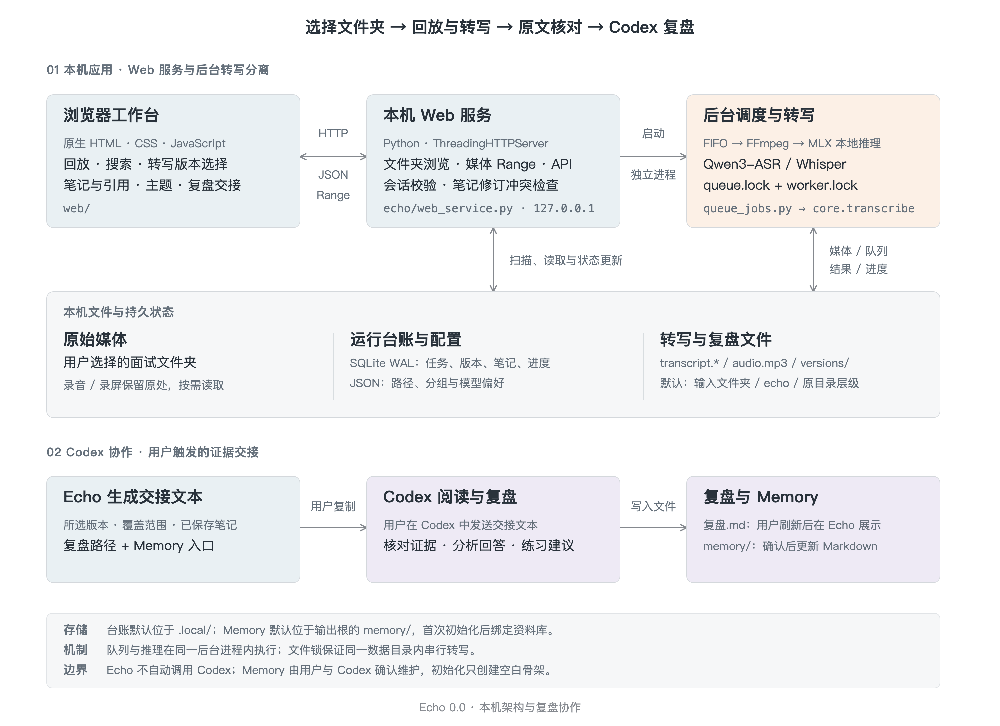

# 回声 · Echo 0.0

**选择面试文件夹，回放录音与录屏、转写文字，再配合 Codex 复盘。**

Echo 是本地 Web 工作台。资料保留在用户选择的位置，浏览器负责回放、原文核对和笔记；Codex 根据选定的转写版本完成分析，Echo 只读展示复盘文档。用户还可以为资料库初始化文件式 Memory，把确认后的背景、偏好与主题结论留给后续复盘使用。当前源码版本为 `0.0.0`。

主流程：**选择文件夹 → 扫描 → 回放 → 转写与核对 → 交给 Codex 复盘**。未转写的记录也可以播放。

**第一次使用？** 跟着 [新手 Cookbook](docs/cookbook.md) 完成一场面试的回放、试转和复盘；应用侧栏的“使用指南”也可以随时打开。

## 启动

推荐 Python 3.13；本地模型转写面向 Apple Silicon Mac。先获取源码，再创建环境：

```sh
git clone https://github.com/Shichaoxx/Echo.git
cd Echo
python3.13 -m venv .venv
.venv/bin/python -m pip install -r requirements.txt
./start.command
```

打开终端输出的实际 `url`，默认是 [本地工作台](http://127.0.0.1:18770/)。点击“选择文件夹”，选择已有的面试资料目录，再点击“保存并扫描文件夹”。打开记录即可回放，无需把资料复制到源码目录。

需要语音转文字时，再安装 FFmpeg 和 ASR 依赖：

```sh
brew install ffmpeg
.venv/bin/python -m pip install -r requirements-asr.txt
```

重启服务后，先试转有对话的一小段，再处理整场。模型首次使用需要联网下载；准备好后在本机推理，不需要云端推理 API key。真实波形也需要 FFmpeg；缺少时仍可用时间轴回放浏览器支持的媒体。

已有环境可用 `ECHO_PYTHON=/path/to/venv/bin/python ./start.command`。端口占用可用 `ECHO_PORT=0 ./start.command`，以实际输出地址为准。关闭网页不会停止已经提交的转写任务。

## 总览与可搬迁资料库

新增“总览与备考”：查看面试状态、打开下一轮准备和跨场材料，并继续上次回听。场次可显式设置采用版本；新转写不会自动替代它，复盘与浏览版本不一致时提示核对。

需要把旧台账与成果统一收进资料目录时，按[资料库整理与恢复](docs/library-storage.md)先预览、备份，再迁移。整理后持久数据放在资料库的 `echo/.state/`，源码可独立更新；原有未整理资料库继续兼容。下面的默认结构描述未迁移的旧模式。

## 保存位置与输出结构

输入是用户选择的音频、录屏文件夹。原媒体留在原处；默认输出根目录是该文件夹下的 `echo/`，也可在设置中选择独立输出目录。默认按原媒体的父目录层级保存结果；选择“按公司”输出结构时，会按识别的公司补充分组。以下为虚构示例：

```text
面试记录/
├── 公司A/一面/录屏.mov                 # 原始输入
└── echo/                             # 默认输出根目录
    ├── 公司A/一面/                    # 本场结果目录
    │   ├── transcript.json           # 结构化转写与来源信息
    │   ├── transcript.txt            # 纯文本逐字稿
    │   ├── transcript.srt            # 带时间戳字幕
    │   ├── review.md                 # 自动转写核对草稿
    │   ├── review.json               # 自动标记的待核对片段
    │   ├── audio.mp3                 # 本次转写范围的音频缓存
    │   ├── versions/
    │   │   └── <run_id>/             # 后续转写版本，同样的六个文件
    │   └── 复盘.md                    # 用户与 Codex 维护，非自动生成
    ├── 面试总结.md                    # 按需整理的跨场报告
    └── memory/                       # 用户显式初始化后创建
        ├── MEMORY.md                 # 索引与阅读顺序
        ├── profile.md                # 已确认的背景、目标与偏好
        ├── topics/                   # 按需添加主题 Markdown
        └── .echo-memory.json         # 资料库归属标记
```

树中的复盘、总结和主题文件只有在实际保存后才存在。设置中的“转写、Codex 复盘与 Memory”展示保存位置；当前场次的复盘文件和 Memory 以实际解析或绑定的位置为准。更改输出设置不会搬动原媒体或历史结果。

### 转写版本

| 文件 | 内容与用途 |
| --- | --- |
| `transcript.json` | 转写结果、片段时间戳、模型和来源等元数据，供工作台加载及核对覆盖范围。 |
| `transcript.txt` | 便于阅读、复制的纯文本，不包含完整时间戳与来源信息。 |
| `transcript.srt` | 字幕格式，可配合媒体回放；时间精度取决于模型，Qwen 的时间戳为音频块范围。 |
| `review.md` | 自动生成的时间戳文本与待核对提示，属于转写草稿，不是 Codex 的面试分析。 |
| `review.json` | 启发式标记的片段及原因；没有标记也不代表转写无误。 |
| `audio.mp3` | 经过处理的播放缓存，仅覆盖本次转写范围，片段试转时不是整场音频。 |

首次转写写入本场结果目录；已有结果时，新转写写入 `versions/<run_id>/`，不覆盖旧文件。相同参数的已完成任务可能复用已有结果。每个版本保留自己的来源和覆盖范围，复盘引用时应注明所用版本。

### 笔记、引用与 Codex 交接

笔记和原文引用保存在运行数据目录的 `ledger.sqlite3` 中，以修订记录保存；引用关联转写版本、时间范围和原文。它们不会自动生成本场目录下的 `notes.md`。需要独立文件时，可通过“更多 → 导出资料”选择保存位置。

“交给 Codex 复盘”生成当前场次与版本的交接文字，包含来源、覆盖范围、笔记、实际复盘路径和 Memory 状态。交接文字供用户复制，不自动保存为交接文件，也不自动同步 Codex 对话。需要保留的共同讨论与结论应写入本场复盘文档。

### 单场复盘与跨场总结

单场分析默认保存为本场结果目录中的 `复盘.md`。同一输入目录有多个媒体时，使用 `<媒体名>.复盘.md` 区分；已有旧复盘路径继续兼容，准确位置以服务返回的 `review.path` 为准。不同转写版本共用本场复盘，通过来源版本编号区分证据。

复盘文档包含机器可读的 `echo-review` 元数据注释，以及本场结论、来源与覆盖范围、逐题复盘、做得好的部分、优先补强与练习、追加记录。用户与 Codex 保存文档后，在“Codex 复盘”页签刷新查看；后续讨论按日期追加，保留证据与修订过程。

`面试总结.md` 放在确认的输出根目录，由用户明确选择纳入场次后与 Codex 按需整理。它记录报告日期、纳入场次、来源版本、共性问题和行动建议，不会自动生成，也不在单场复盘页签展示。详细格式见 [Codex 复盘标准](docs/codex-review.md)。

### 文件式 Memory

Memory 首次初始化在当时的输出根目录下创建 `memory/`，只建立空模板，不分析全部面试。各文件职责如下：

| 位置 | 内容与维护方式 |
| --- | --- |
| `MEMORY.md` | 简短索引、阅读顺序与主题入口，帮助 Codex 按需读取相关材料。 |
| `profile.md` | 用户提供或确认的背景、目标与偏好，不把模型推断直接写成个人事实。 |
| `topics/*.md` | 按需创建的主题认识与行动，保留稳定条目 ID、证据、确认状态和修订历史。 |
| `.echo-memory.json` | Echo 创建的归属标记，用于校验资料库绑定，不是复盘正文。 |

候选认识先保留在单场复盘，用户确认后再写入 Memory。每个源文件夹独立绑定 Memory；之后更换输出位置仍沿用原绑定，避免出现多份权威副本。Memory 保存当前确认的理解，单场复盘保留讨论过程，跨场总结保留指定范围和日期的报告。详见 [Memory 使用与维护](docs/memory.md)。

### 本机运行数据

运行数据与上述结果文件分开，默认在源码目录的 `.local/`，可通过 `INTERVIEW_DATA_DIR` 指定其他位置。主要包括：

| 文件 | 用途 |
| --- | --- |
| `ledger.sqlite3` | 面试台账、转写版本与任务状态、笔记及引用修订。 |
| `paths.json` | 输入、输出目录与输出结构配置。 |
| `library.json` | 资料库自定义分组与记录元数据。 |
| `memory-locations.json` | 源文件夹到 Memory 实际位置的绑定。 |
| `memory-locations.lock`、`queue.lock`、`worker.lock` | 协调绑定修改、任务调度与转写资源的运行锁。 |

备份时应同时保留原媒体、输出目录、实际绑定的 Memory 和运行数据目录；只复制转写文本无法恢复笔记、版本台账或绑定。真实资料和运行配置属于私人数据，不应提交到公开 Git 仓库。

## 能力与边界

- 回放支持时间定位、倍速、A–B 循环与录屏展开；有转写后可点击原文定位、搜索与跟随播放。
- 界面提供六种主题及跟随系统选项，支持侧栏调整、快捷搜索与使用指南。
- 本地转写支持 Qwen3-ASR 和 Whisper，任务串行排队；Qwen 时间戳是音频块范围，技术名词和双方发言需人工核对。
- 笔记和原文引用保存在本机。点击“交给 Codex 复盘”会生成当前场次、当前版本的交接内容，用户复制到 Codex 后再进行分析。
- 文件式 Memory 保存用户确认的背景、偏好和有来源的主题结论。Codex 先读索引、再读相关主题；Echo 不自动生成画像、语义检索或演化 Skill。
- 当前只维护 Web 工作台。服务仅监听本机，没有多人账号或应用层数据加密。

## 架构

原生 Web 界面对接 Python 本机服务；独立后台进程从 SQLite 队列取任务，并在同一进程内串行执行本地 ASR。版本追加、源文件校验和笔记修订保护资料；Codex 通过用户交接参与复盘，用户确认后的认识保存在绑定的 Memory 中。



[架构与代码证据](docs/architecture.md) · [SVG 矢量图](docs/figures/echo-architecture.svg) · [PDF](docs/figures/echo-architecture.pdf)

## 参与开发

欢迎提交问题反馈和改进建议。反馈时请说明运行环境、复现步骤和预期行为，使用虚构或脱敏材料，不上传真实面试录音、逐字稿、笔记、Memory 或本机配置。开发与验证步骤见 [开发说明](docs/development.md)。当前 `0.0.0` 是早期版本；已实现能力与限制以本文及源码为准。

## 文档

- **[第一次使用：从录音到一场复盘](docs/cookbook.md)**：跟着操作完成 60 秒试转、全场转写、笔记引用与 Codex 交接。
- [使用指南](docs/usage.md)：操作、目录、模型、隐私与备份。
- [Codex 复盘标准](docs/codex-review.md)：交接步骤、来源核对和复盘文档协议。
- [Memory 使用与维护](docs/memory.md)：资料库绑定、确认流程、主题条目与修订记录。
- [开发说明](docs/development.md)：实现职责、验证与源码发布。

Echo 自有代码采用 [MIT](LICENSE)；模型与依赖遵循各自许可证，源码不附带模型权重。感谢 Qwen3-ASR、MLX Audio 和 MLX Whisper。
