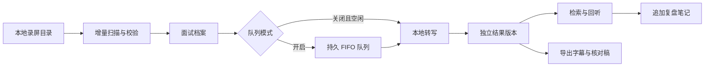

# 回声 · Echo

**把面试录屏整理成可检索、可回听、持续积累的本地资料库。**

一个自己用的面试复盘小工具，运行在 Apple Silicon Mac 上。用本地模型把录屏转成文字，方便回听和记笔记，不需要云端推理 API key。

`v0.1.0` · `macOS / Apple Silicon` · `Python 3.13 已验证` · `MIT`

## 功能

- **持续追加**：增量扫描录屏，文件变化生成新版本，历史记录与笔记保留。
- **本地转写**：Qwen3-ASR、Whisper Large-v3、Whisper Turbo，支持中文、中英混合、英语及自动识别。
- **任务队列**：持久排队、取消等待任务、重复提交去重，失败后继续下一项。
- **实时进度**：阶段、处理块数、耗时及估算剩余时间，完成后自动载入结果。
- **回听复盘**：检索、时间定位、核对提示、追加笔记，导出 TXT / SRT / JSON / Markdown。
- **六套主题**：三套 Light 与三套 Dark，适配窄窗口。

## 快速开始

需要 Apple Silicon Mac、Python 3.13 和 FFmpeg。Windows、Linux 及 Intel Mac 的模型推理尚不支持；无模型测试可在 Linux 运行。

先获取源码，再安装运行：

```sh
brew install python@3.13 ffmpeg
git clone https://github.com/Shichaoxx/Echo.git
cd Echo
python3.13 -m venv .venv
.venv/bin/python -m pip install -r requirements.txt
mkdir -p recordings
./start.command
```

打开 [本地工作台](http://127.0.0.1:8501/)，在侧栏「导入与目录设置」选择目录并扫描。选择面试，先试转一段实际对话，再提交完整转写。

模型首次使用从 Hugging Face 下载，需要网络和足够磁盘空间。就绪后推理在本机执行。关闭浏览器不会停止已经启动的后台任务；电脑休眠会影响处理。

默认录屏目录为 `recordings/`，运行数据在 `.local/`，两者均不进入 Git。自定义路径：

```sh
INTERVIEW_SOURCE_DIR="/path/to/recordings" ./start.command
INTERVIEW_DATA_DIR="/path/to/local-data" ./start.command
```

详细操作见 [使用指南](docs/usage.md)。

## 工作流程



## 面试归档

双击 `scripts/archive.command`，按场次整理录屏入口、全部转写版本、复盘与练习，并保存台账快照。已有录屏路径保持不变，手写复盘不会被覆盖。目录约定与备份边界见 [归档指南](docs/archive.md)。

## 模型选择

| 模型 | 精度 | 权重约大小 | 当前时间戳 |
| --- | --- | --- | --- |
| Qwen3-ASR 1.7B（默认） | BF16 | 4.08 GB | 音频块范围 |
| Whisper Large-v3 | FP16 | 3.08 GB | 模型片段时间戳 |
| Whisper Turbo | FP16 | 1.61 GB | 模型片段时间戳 |

权重大小不等于运行内存需求。Qwen 与 Turbo 已进行本机推理验证；Large-v3 已接入，尚未完成本项目的本机端到端验证。项目不提供未经人工参考稿验证的准确率排名。

Qwen 默认按最多 25 秒分块，尽量在低音量处切分，整场都会处理。各块独立识别，时间戳尚未逐词对齐，字幕也使用块级范围。技术缩写、人名和产品名仍需回听。

## 数据与隐私

程序默认仅监听 `127.0.0.1`。数据库包含源文件路径，转写稿、日志、队列参数和截图可能包含私人信息，不应提交或附在公开 Issue 中。

`.gitignore` 只是辅助措施，不能清除旧 Git 历史，也不能阻止强制添加文件。开源准备包含当前源码检查及不携带旧历史的发布包流程。参阅 [隐私边界](docs/privacy.md) 和 [发布流程](docs/releases.md)。

## 当前边界

- 解析音轨，不区分说话人，不识别屏幕代码，不生成面试评分。
- 核对提示不是准确率；近乎静音过滤可关闭。
- GPU 转写串行执行；队列用于连续提交，不是并行推理。
- 中断后从头重试，不支持音频中途续算；移动文件会建立新档案。
- 本地数据未加密，不提供账号认证；请勿直接暴露到公网。

## 文档与维护

```sh
.venv/bin/python -m unittest -q
.venv/bin/python scripts/check_public.py
```

| 文档 | 内容 |
| --- | --- |
| [使用指南](docs/usage.md) | 模型、队列、命令行、备份和排错 |
| [架构与流程图](docs/architecture.md) | 模块、状态机、数据流和版本关系 |
| [版本记录](docs/changelog.md) | 版本变化与兼容性 |
| [版本与打包](docs/releases.md) | 更新版本、打包源码 |

## 许可与上游

代码采用 [MIT License](LICENSE)。模型权重与依赖按各自许可证分发，发布包不包含模型。

感谢 [Qwen3-ASR](https://huggingface.co/Qwen/Qwen3-ASR-1.7B)、[MLX Audio](https://github.com/Blaizzy/mlx-audio)、[MLX Whisper](https://github.com/ml-explore/mlx-examples/tree/main/whisper) 和 [Streamlit](https://github.com/streamlit/streamlit)。

## 交互与 Codex 复盘

全局队列显示执行、等待、完成与异常记录；等待任务可修改参数并保留审计记录，运行任务参数固定。转写设置按面试保留会话草稿，提交前显示范围与模型，并校验视频时长。

Codex 在原存档目录维护 `复盘.md` 和根目录的 `面试总结.md`，Echo 读取展示。统一协议见 [Codex 复盘标准](docs/codex-review.md)。

## 项目目录

`echo/` 存放业务实现，`assets/` 存放样式，`tests/` 存放测试，`scripts/` 存放维护工具，`docs/` 存放文档。根目录仅保留常用入口与项目配置。双击 `start.command` 启动；原 CLI 命令保持兼容。发布产物位于 `.local/releases/`。
