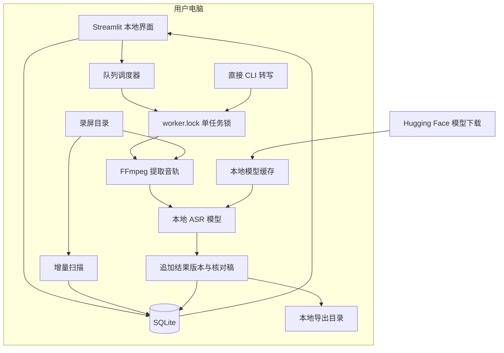
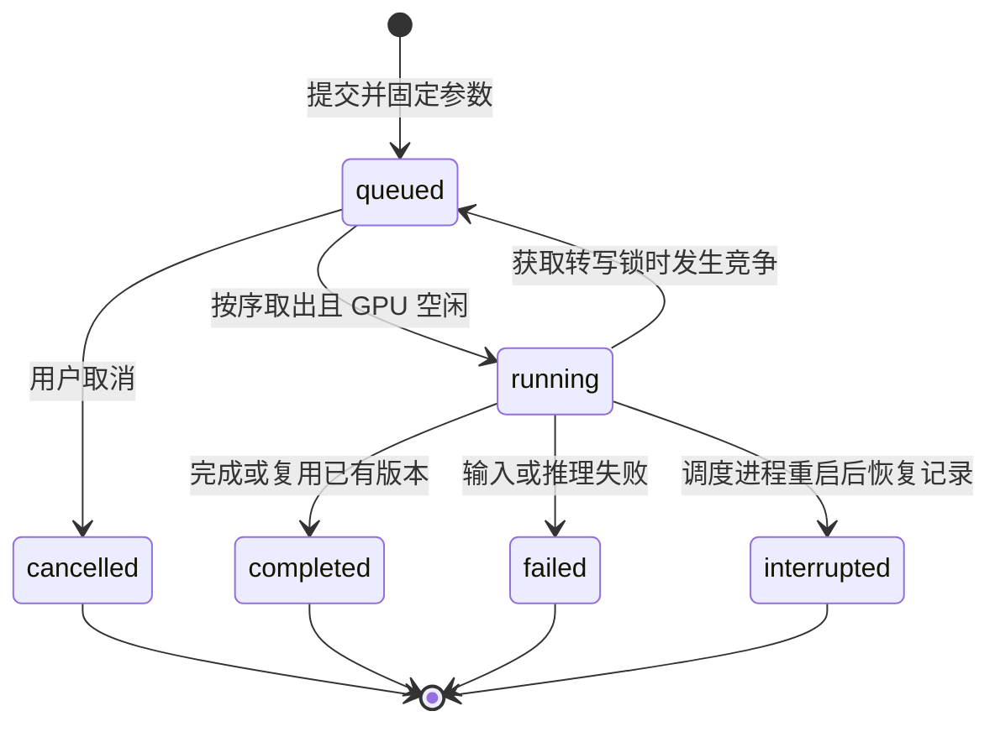
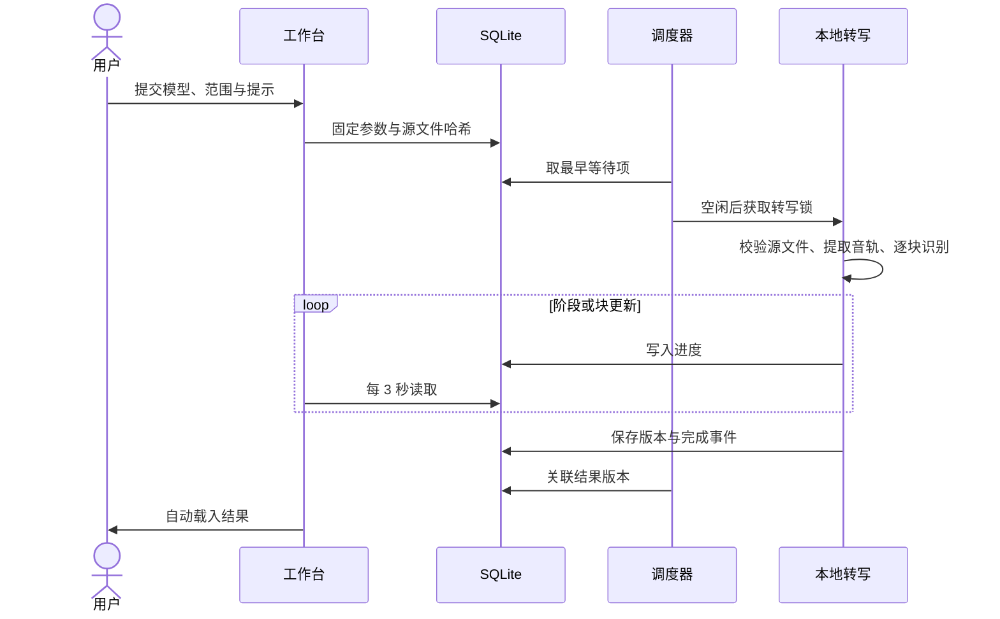
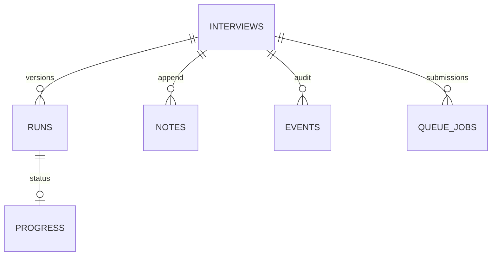

# 架构与流程

## 模块

| 模块 | 职责 |
| --- | --- |
| `app.py`、`interview.py`、`queue_jobs.py` | 稳定的工作台、CLI 与后台入口 |
| `echo/paths.py` | 数据、媒体输入和结果输出路径；配置优先级、保存与失效目录保护 |
| `echo/workspace.py`、`echo/ui/` | Streamlit 导航、偏好、提交、阅读与局部进度刷新 |
| `echo/interview.py` | 扫描、文件校验、SQLite 台账、转写生命周期、导出 |
| `echo/asr_models.py` | 模型注册、下载、Whisper/Qwen 适配与分段 |
| `echo/queue_jobs.py` | 持久 FIFO、去重、取消、后台调度 |
| `echo/library.py`、`echo/workspace_review.py` | 个人资料、资料库元数据和 Markdown 复盘读取 |
| `echo/task_status.py`、`echo/transcription_ui.py` | 时间估算、媒体时长与提交范围校验 |
| `echo/themes.py`、`assets/` | 主题、布局、逐字稿和播放器交互 |
| `scripts/` | 归档、扫描与源码发布工具 |

界面调用业务包；模型推理留在适配模块，台账与队列继续使用 SQLite。v1 的整理集中在入口、业务实现和路径配置边界，数据库格式保持兼容。

## 目录配置与运行边界

`echo/paths.py` 是路径解析的统一入口。运行数据目录由 `INTERVIEW_DATA_DIR` 指定，默认项目根下 `.local/`；其中的 `paths.json` 保存媒体输入与结果输出配置。输入优先读取 `INTERVIEW_SOURCE_DIR`，再读取 `paths.json`、兼容配置 `source_path.txt`，最后使用项目根下 `recordings/`。输出优先读取 `INTERVIEW_OUTPUT_DIR`，再读取 `paths.json`，最后使用数据目录下 `outputs/`。

工作台和 CLI 共用配置，启动 worker 和 dispatcher 时传递生效的数据根并继承环境变量，避免子进程回落到另一份数据。输入与输出在使用时读取共享配置，使已有 dispatcher 的后续任务也能使用新设置。配置更改不会移动既有源文件、转写结果或台账；历史结果继续按照台账保存的路径读取。

首次初始化允许在已有父目录下建立数据根。失效的外部符号链接、缺失的上级目录，以及进程已加载后消失的数据根都会触发错误。后台轮询不再通过递归创建父目录“修复”这些情况，避免移动项目或删除旧目录后又生成空目录和台账。

## 数据流与网络边界



下载模型需要网络；转写音频通过本地文件交给模型。界面不上传录音用于云端推理。不能据此推断依赖没有任何网络行为，详见隐私文档。

## 队列状态机



`queue.lock` 保证单调度器，`worker.lock` 保证单 GPU 转写。正在执行的旧任务无需改造或重启；调度器等待其释放锁。失败不阻塞后续任务，重试通过再次提交产生新记录。

## 转写时序



## 版本与数据关系



每场档案以路径建档，内容哈希用于变化识别。相同模型、来源及参数已有完成结果时复用；强制重跑保留旧版本。队列完成记录中的 run_id 是应用层关联。raw_segments 保留模型原始片段，展示片段包含核对注释和原录屏时间偏移。

数据库以 CREATE TABLE IF NOT EXISTS 增量建表。v1.0.0 继续使用兼容台账格式，没有单独的迁移版本表；未来破坏性变更必须提供备份与迁移方案。

## 源码目录

```text
Echo/
├── start.command            双击启动
├── app.py                   Streamlit 稳定入口
├── interview.py             原 CLI 兼容入口
├── queue_jobs.py            后台队列兼容入口
├── echo/                    业务实现
│   ├── workspace.py         详情与阅读界面
│   ├── paths.py             统一目录配置与失效路径保护
│   ├── ui/                  全局队列及共享显示函数
│   ├── interview.py         转写与台账
│   ├── asr_models.py        模型适配
│   └── ...                  队列、主题、复盘读取
├── assets/                  样式
├── tests/                   合成数据测试
├── scripts/                 归档、扫描、发布等维护工具
├── docs/                    使用、协议、开发与变更记录
└── .local/                  本机数据入口（不进入 Git）
```

旧 CLI 继续使用根目录兼容入口。业务模块通过 `echo` 包导入；项目根用于定位代码和静态资源，运行数据通过独立配置定位。移动项目不会自动修复绝对路径或外部符号链接；移动前需停止进程，移动后核对目录和历史结果。`python -m unittest -q` 从 tests 包发现测试。

## 桌面版本演进

下一阶段以原生 macOS 外壳承载独立窗口和目录选择，并统一管理本地服务的启动与退出。业务包、台账、队列和模型适配继续复用；服务接口与桌面生命周期属于下一版本的实现范围。v1 不包含桌面安装包。

## 资料库与个人上下文

`echo/library.py` 管理本机 `profile.json` 和 `library.json` 的原子写入、日期解析、公司归一及分组。覆盖值以稳定 interview_id 关联，不修改媒体台账；日期无法推断时留空，年份未知独立分组。Profile 由用户填写，供 Codex 作为待核对背景使用。

`echo/ui/library_panel.py` 和 `echo/ui/profile.py` 负责导航、档案表单与个人资料页。`echo/ui/transcript.py` / `assets/transcript.js` 在客户端处理连续阅读、搜索和片段高亮，使用 textContent 渲染转写。时间戳通过局部播放器 ID 发送定位事件；`player_controls.js` 管理唯一音频实例。`assets/workspace.css` 提供基于主题变量的毛玻璃布局，保留原主题样式和队列组件。
