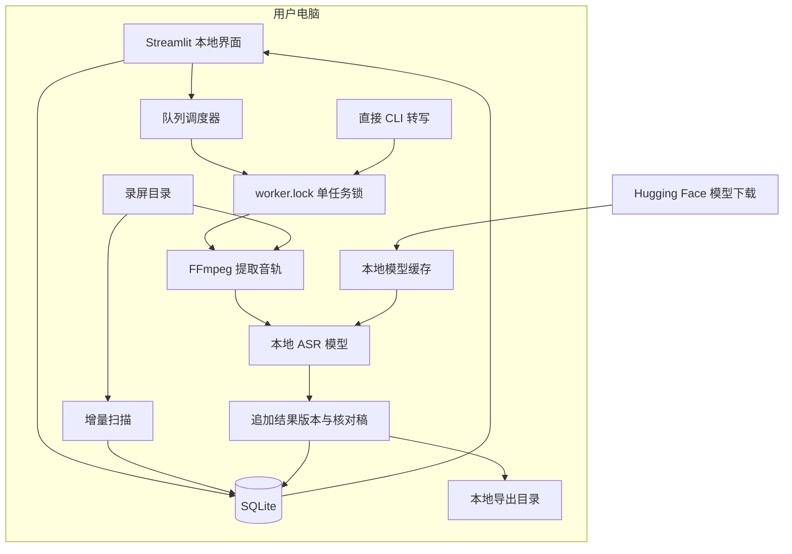
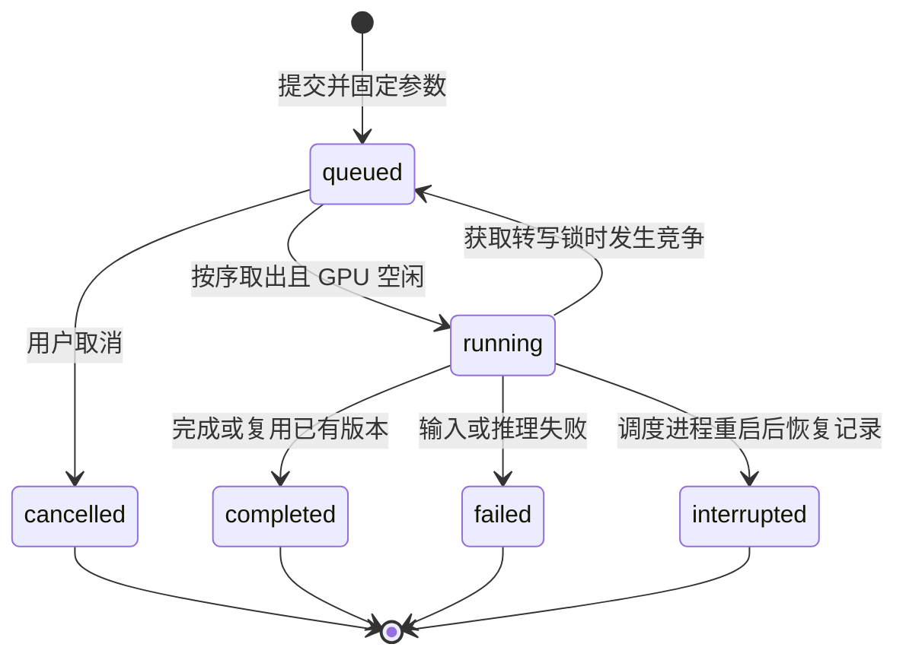
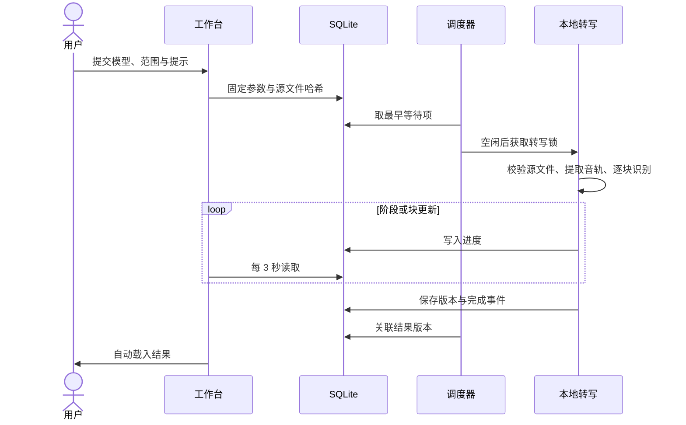
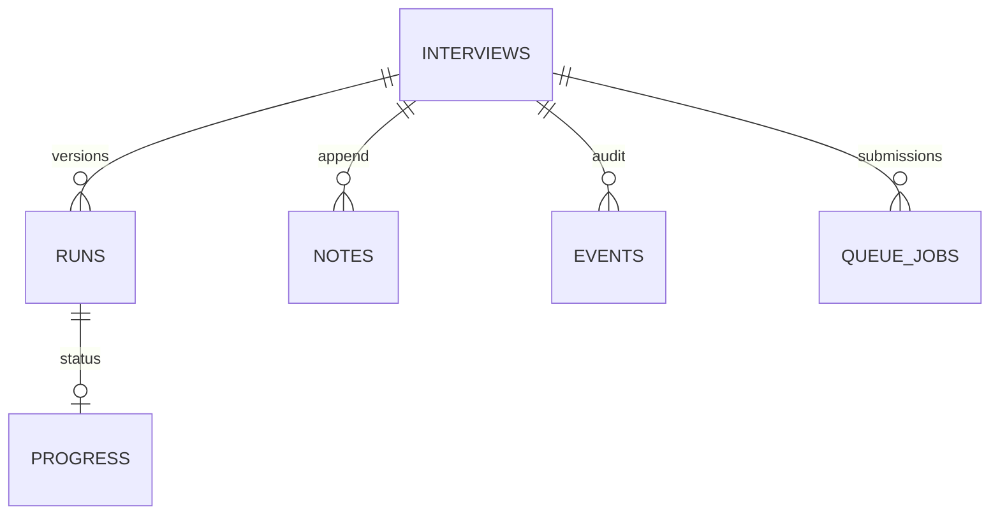

# 架构与流程

## 模块

| 模块 | 职责 |
| --- | --- |
| app.py | Streamlit 工作台、偏好、提交、局部进度刷新 |
| interview.py | 扫描、文件校验、数据库、转写生命周期、导出 |
| asr_models.py | 模型注册、下载、Whisper/Qwen 适配与分段 |
| queue_jobs.py | 持久 FIFO、去重、取消、后台调度 |
| task_status.py | 耗时与基于实际进度的时间估算 |
| themes.py / style.css | 六套配色与布局 |

## 数据流与网络边界

下载模型需要网络；转写音频通过本地文件交给模型。界面不上传录音用于云端推理。不能据此推断依赖没有任何网络行为，详见隐私文档。

## 队列状态机

`queue.lock` 保证单调度器，`worker.lock` 保证单 GPU 转写。正在执行的旧任务无需改造或重启；调度器等待其释放锁。失败不阻塞后续任务，重试通过再次提交产生新记录。

## 转写时序

## 版本与数据关系

每场档案以路径建档，内容哈希用于变化识别。相同模型、来源及参数已有完成结果时复用；强制重跑保留旧版本。队列完成记录中的 run_id 是应用层关联。raw_segments 保留模型原始片段，展示片段包含核对注释和原录屏时间偏移。

数据库以 CREATE TABLE IF NOT EXISTS 增量建表。v0.1.0 没有单独的迁移版本表；未来破坏性变更必须提供备份与迁移方案。
